<div align="center">


<br/><br/>

# 🚌 SDBS — Smart Dynamic Bus System

**A Full-Stack Flutter + Firebase Intelligent Transit Management Platform**  
*Connecting passengers, drivers, and administrators with real-time fleet synchronization and capacity-aware dispatch decisions.*

<br/>

[📱 Features](#-features) • [📸 App Showcase](#-app-showcase) • [🧠 Decision Engine](#-decision-engine) • [🗃️ Data Model](#️-firestore-data-model) • [🔐 Security](#-security-rules) • [🚀 Getting Started](#-getting-started) • [📁 Architecture](#-project-structure)

</div>

---

## 📖 Project Overview

**SDBS (Smart Dynamic Bus System)** is an enterprise-grade transit operations solution designed to modernize public transportation. Built with **Flutter** and powered by **Google Cloud Firestore**, SDBS provides real-time bidirectional synchronization between passengers at bus stops, transit drivers navigating routes, and fleet administrators monitoring city-wide operations.

### 🌟 Key Highlights
- **Dynamic Decision Engine:** Real-time algorithmic recommendations (**STOP**, **SKIP**, **EARLY DEPART**) that adapt bus departures to passenger crowd levels and vehicle occupancy.
- **Three Tailored Portals:** Specialized user experiences for **Passengers**, **Drivers**, and **Fleet Admins**.
- **Contactless QR Boarding:** Passengers register instant boarding intent at stops with camera or QR scanning.
- **Closed-Loop Passenger Notifications:** Instant push alerts to waiting passengers if an oncoming bus is skipping or departing early.
- **Digital Transit Wallet:** Built-in balance tracking and immutable transaction ledger for seamless fare payments.
- **Live Fleet Telemetry:** Centralized admin overview of all active buses, real-time passenger counts, and route status.

---

## 📸 App Showcase

### 👤 Passenger Experience
Clean, intuitive mobile interface empowering commuters to view live bus occupancy, scan QR codes at stops, and manage their transit wallet.

<div align="center">
  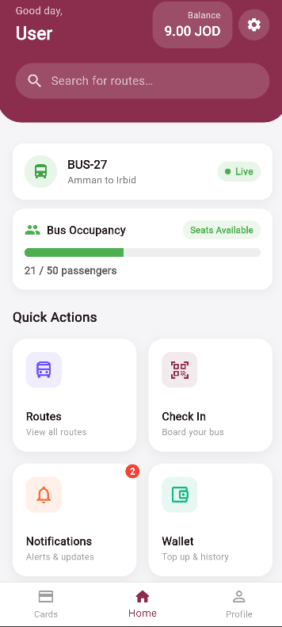
  &nbsp;&nbsp;
  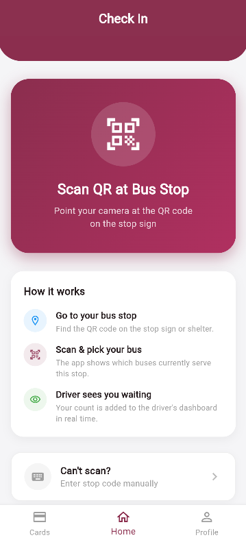
  &nbsp;&nbsp;
  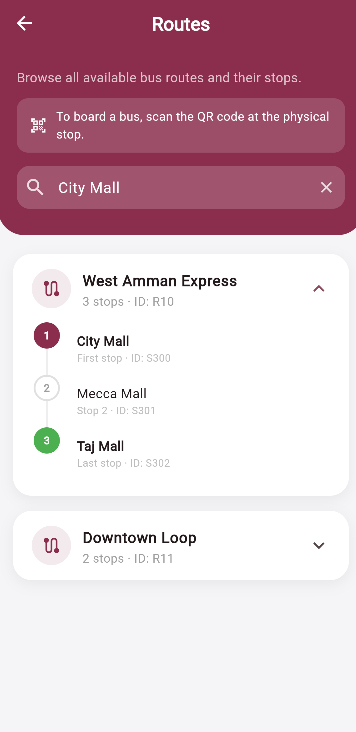
  &nbsp;&nbsp;
  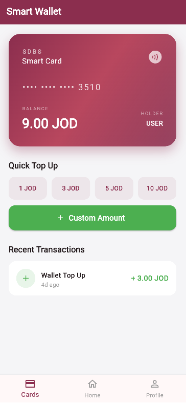
  &nbsp;&nbsp;
  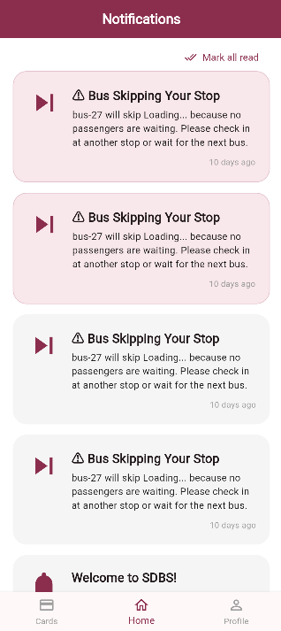
</div>

<br/>

### 🚍 Driver Cockpit & Decision Engine
The driver dashboard evaluates oncoming stop capacity in real-time, giving actionable alerts on whether to stop, skip, or depart early.

<div align="center">
  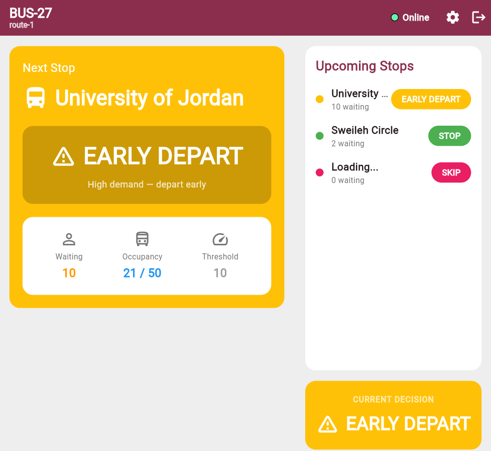
</div>

<br/>

### 🛠️ Admin Control Center & Fleet Intelligence
Comprehensive management console for dispatchers to supervise active routes, track live vehicle occupancy, analyze historical transit metrics, and manage user roles.

<div align="center">
  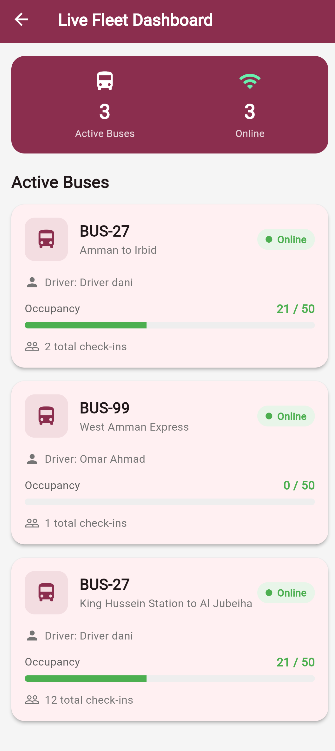
  &nbsp;&nbsp;
  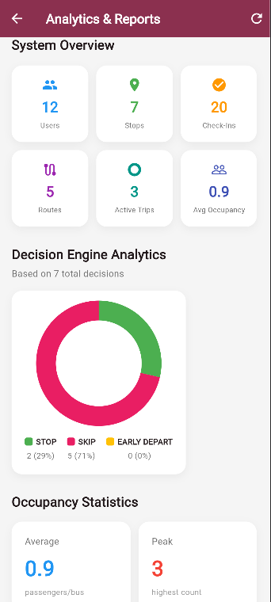
  &nbsp;&nbsp;
  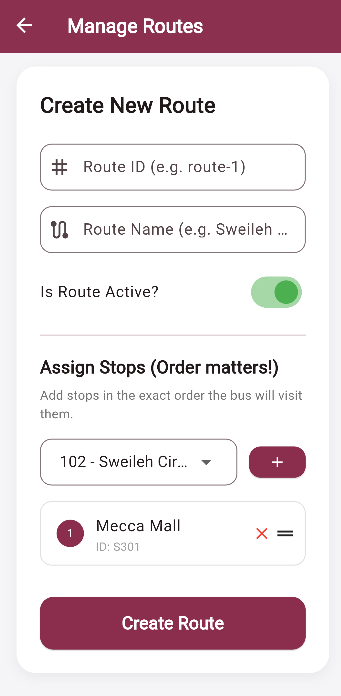
  &nbsp;&nbsp;
  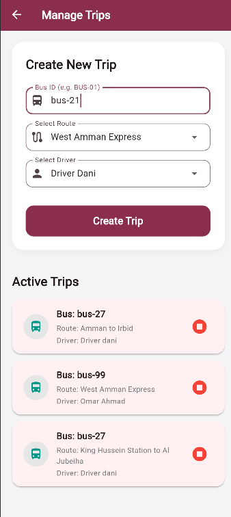
</div>

<br/>

<div align="center">
  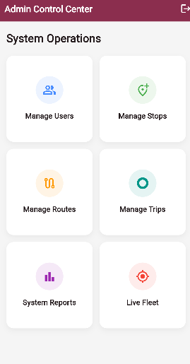
  &nbsp;&nbsp;
  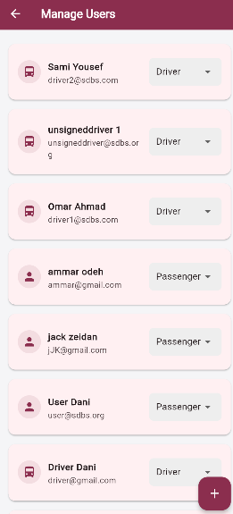
</div>

<br/>

### 🔐 Authentication & Onboarding
Role-aware authentication with input validation, secure password hashing, and Firestore profile creation.

<div align="center">
  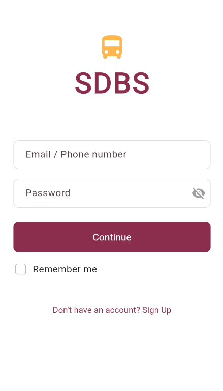
  &nbsp;&nbsp;&nbsp;&nbsp;
  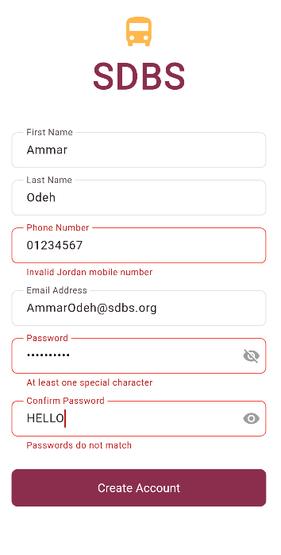
  &nbsp;&nbsp;&nbsp;&nbsp;
  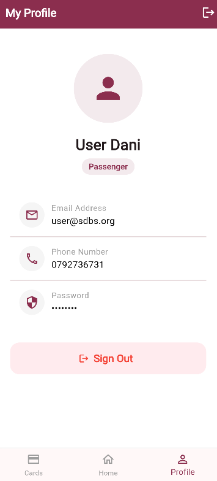
</div>

---

## ✨ Features Breakdown

### 👤 Passenger Module
| Feature | Technical Implementation | Description |
|---|---|---|
| 🔐 **Authentication** | Firebase Auth (Email & Password) | Secure authentication with session persistence and auto-login |
| 🏠 **Home Dashboard** | StreamBuilder + Provider | Real-time active trip status, wallet balance, and quick actions |
| 🟢 **Live Bus Occupancy** | Firestore Real-Time Listener | Visual dynamic progress bar (Green → Orange → Red) based on bus capacity |
| 📷 **QR Check-In** | `mobile_scanner` + `qr_flutter` | Scan stop-specific QR code or enter stop ID manually to register boarding intent |
| 🗺️ **Interactive Routes** | `flutter_map` + OpenStreetMap | Browse active bus routes, stop sequences, and route directions |
| 🔔 **Smart Alerts** | Real-Time Firestore Notifications | Instant alerts if an oncoming bus is skipping or departing early |
| 💳 **Digital Transit Card** | Sub-collection Transactions | Virtual card display, quick top-ups (1, 3, 5, 10 JOD), and transaction log |
| 👤 **Profile & Security** | User Provider | View account info, role verification, and secure sign-out |

### 🚍 Driver Module
| Feature | Technical Implementation | Description |
|---|---|---|
| 🗺️ **Active Trip Cockpit** | Firestore Document Stream | Live display of assigned route, bus number, and active stops |
| 📊 **Real-Time Passenger Counts** | Firestore Aggregation Queries | Instant count of waiting passengers at upcoming stops |
| 🤖 **Automated Decision Engine** | `DecisionService` Core Logic | Evaluates occupancy vs. waiting count vs. thresholds per stop |
| 📣 **Automated Passenger Alerts** | Firestore Notification Batching | Pushes SKIP or EARLY DEPART alerts to waiting passengers at affected stops |
| 🏁 **Trip Completion** | Atomic Firestore Batch Write | Marks trip completed, resets occupancy, and archives check-in intents |

### 🛠️ Administrator Module
| Feature | Technical Implementation | Description |
|---|---|---|
| 👥 **User Management** | Firestore RBAC | Search, filter, and promote users between Passenger and Driver roles |
| 📍 **Stop Management** | GPS Coordinates & Thresholds | Add/edit bus stops with geo-coordinates and custom crowd limits |
| 🔀 **Route Sequencing** | Array of Reference IDs | Build multi-stop routes with custom ordering and active/inactive toggles |
| 🚌 **Trip Dispatcher** | Relational Document Linking | Assign driver, bus, and route to initiate live transit trips |
| 📡 **Live Fleet Telemetry** | Multi-document Snapshot Streams | High-level fleet dashboard tracking all active buses and passenger loads |
| 📊 **Transit Analytics** | Decision Logging & Donut Charts | Visual reports on STOP/SKIP/EARLY DEPART ratios and high-demand stops |

---

## 🧠 Decision Engine

The core differentiator of SDBS is its **Capacity-Aware Decision Engine** (`DecisionService`). At every stop along an active trip, the system evaluates real-time telemetry to recommend the optimal operational decision:

$$\text{Available Seats} = \text{Bus Capacity} - \text{Current Occupancy}$$

### Decision Rules Priority Matrix

```
┌─────────────────────────────────────────────────────────────┐
│ Priority 1: Are there 0 passengers waiting?                 │
│             ──► 🔴 SKIP (Save route time and fuel)          │
├─────────────────────────────────────────────────────────────┤
│ Priority 2: Is the bus completely full (Occupancy >= Cap)?  │
│             ──► 🔴 SKIP (Cannot board any more passengers)  │
├─────────────────────────────────────────────────────────────┤
│ Priority 3: Does waiting count exceed available seats?      │
│             ──► 🟢 STOP (Board to maximum, warn leftovers)  │
├─────────────────────────────────────────────────────────────┤
│ Priority 4: Waiting count >= Stop Threshold & seats exist?  │
│             ──► 🟡 EARLY DEPART (Rush to clear crowd surge) │
├─────────────────────────────────────────────────────────────┤
│ Priority 5: Default condition (Normal operations)           │
│             ──► 🟢 STOP (Regular passenger boarding)        │
└─────────────────────────────────────────────────────────────┘
```

> **Audit Trail & Event Notifications:**  
> Every generated decision is written to the immutable `stopDecisions` collection with trip metadata, timestamp, waiting count, and occupancy. Passengers waiting at that stop receive immediate push notifications if a **SKIP** or **EARLY DEPART** occurs.

---

## 🗃️ Firestore Data Model

```
📦 Cloud Firestore
├── 👥 users/{uid}
│   ├── firstName: string
│   ├── lastName: string
│   ├── email: string
│   ├── phone: string
│   ├── role: "Passenger" | "Driver" | "Admin"
│   ├── balance: number (JOD)
│   └── 💰 transactions/{txId}      # Immutable audit trail of top-ups
│       ├── amount: number
│       ├── timeStamp: timestamp
│       └── type: "top_up"
│
├── 📍 stops/{stopId}
│   ├── name: string
│   ├── latitude: double
│   ├── longitude: double
│   └── maxThreshold: int           # Crowd surge threshold for early departure
│
├── 🔀 routes/{routeId}
│   ├── name: string
│   ├── isActive: boolean
│   └── stopIds: string[]           # Ordered sequence of stop references
│
├── 🚌 buses/{busId}
│   ├── capacity: int (default: 50)
│   └── currentOccupancy: int
│
├── 🚦 trips/{tripId}
│   ├── busId: string
│   ├── routeId: string
│   ├── driverId: string
│   ├── status: "active" | "completed"
│   └── startTime: timestamp
│
├── ✅ checkIns/{checkInId}
│   ├── passengerID: string
│   ├── tripID: string
│   ├── stopID: string
│   └── timeStamp: timestamp
│
├── 📋 stopDecisions/{decisionId}
│   ├── action: "STOP" | "SKIP" | "EARLY"
│   ├── reason: string
│   ├── tripId: string
│   ├── busId: string
│   ├── stopId: string
│   ├── waitingCount: int
│   └── occupancy: int
│
├── 🔔 notifications/{notifId}
│   ├── userId: string
│   ├── title: string
│   ├── description: string
│   ├── type: "skip" | "early_depart" | "general"
│   ├── read: boolean
│   └── timeStamp: timestamp
│
└── 📊 occupancyRecords/{recordId}
    ├── busId: string
    ├── occupancy: int
    └── timestamp: timestamp
```

---

## 🔐 Security Rules

Role-Based Access Control (RBAC) is enforced directly at the database layer via `firestore.rules`:

```javascript
rules_version = '2';
service cloud.firestore {
  match /databases/{database}/documents {
    
    function isAuth() { return request.auth != null; }
    function isOwner(uid) { return isAuth() && request.auth.uid == uid; }
    function isAdmin() { return isAuth() && request.auth.token.role == 'Admin'; }

    // Users: Users can read/edit their profile, but cannot elevate role or balance
    match /users/{uid} {
      allow read: if isAuth();
      allow update: if (isOwner(uid) 
                        && request.resource.data.role == resource.data.role
                        && request.resource.data.balance == resource.data.balance)
                     || isAdmin();
      
      // Wallet transactions: Append-only ledger
      match /transactions/{txId} {
        allow read: if isOwner(uid) || isAdmin();
        allow create: if isOwner(uid) || isAdmin();
        allow update, delete: if false; // Immutable ledger
      }
    }

    // Check-ins: Passengers can only register check-in intents for themselves
    match /checkIns/{checkInId} {
      allow read: if isAuth();
      allow create: if isAuth() && request.resource.data.passengerID == request.auth.uid;
      allow delete: if isAuth();
    }

    // Decisions: Audit records cannot be tampered with
    match /stopDecisions/{docId} {
      allow read: if isAuth();
      allow create: if isAuth();
      allow update, delete: if false;
    }
  }
}
```

---

## 🛠️ Tech Stack

| Layer | Technology | Purpose |
|---|---|---|
| **Frontend Framework** | [Flutter 3.x](https://flutter.dev/) | Cross-platform UI for Android, iOS, and Web |
| **Language** | [Dart 3.x](https://dart.dev/) | Null-safe, modern reactive programming |
| **Backend & Database** | [Google Cloud Firestore](https://firebase.google.com/docs/firestore) | NoSQL real-time document synchronization |
| **Authentication** | [Firebase Auth](https://firebase.google.com/docs/auth) | Email and password authentication service |
| **State Management** | [Provider](https://pub.dev/packages/provider) | Declarative state propagation across views |
| **Mapping Engine** | [flutter_map](https://pub.dev/packages/flutter_map) + [latlong2](https://pub.dev/packages/latlong2) | High-performance open-source mapping |
| **QR Code Pipeline** | [mobile_scanner](https://pub.dev/packages/mobile_scanner) + [qr_flutter](https://pub.dev/packages/qr_flutter) | Hardware camera barcode scanning & rendering |
| **Form Validation** | [form_validator](https://pub.dev/packages/form_validator) | Resilient client-side validation |

---

## 🚀 Getting Started

### Prerequisites
- [Flutter SDK](https://flutter.dev/docs/get-started/install) (`^3.9.2` or later)
- [Firebase CLI](https://firebase.google.com/docs/cli)
- Android Studio / VS Code with Flutter extensions
- A Firebase project with **Authentication** and **Firestore** initialized

### Installation & Local Run

```bash
# 1. Clone repository
git clone https://github.com/ALDANI-MO/smart-dynamic-bus-system.git
cd smart-dynamic-bus-system

# 2. Install Flutter packages
flutter pub get

# 3. Connect to your Firebase project
#    Ensure you have logged in to firebase (firebase login)
flutterfire configure

# 4. Deploy Firestore security rules
firebase deploy --only firestore:rules

# 5. Launch application on connected device or Chrome
flutter run
```

---

## 📁 Project Structure

```
smart-dynamic-bus-system/
├── lib/
│   ├── main.dart                   # Entry point, Firebase initialization & Provider bindings
│   ├── firebase_options.dart       # Generated Firebase configuration
│   ├── auth/
│   │   ├── login.dart              # User authentication screen
│   │   └── signup.dart             # Passenger registration form
│   ├── home/
│   │   ├── home.dart               # Passenger home dashboard & live occupancy view
│   │   ├── cards.dart              # Smart wallet & transaction history
│   │   └── profile.dart            # User profile, role badges & sign out
│   ├── options/
│   │   ├── check_in.dart           # QR scanning & stop boarding workflow
│   │   ├── qr_scanner_page.dart    # Mobile scanner camera view
│   │   ├── stop_trip_picker.dart   # Manual stop & trip picker
│   │   ├── routes_page.dart        # Route browser & interactive stop map
│   │   └── notifications.dart      # Real-time alert feed for passengers
│   ├── driver/
│   │   └── driver_dashboard.dart   # Driver navigation & live decision engine display
│   ├── admin/
│   │   ├── admin_dashboard.dart    # Admin navigation hub
│   │   ├── manage_users.dart       # User CRUD & role promotions
│   │   ├── manage_stops.dart       # Stop creation, coordinates & thresholds
│   │   ├── manage_routes.dart      # Route sequencing & stop ordering
│   │   ├── manage_trips.dart       # Active trip creation & dispatcher
│   │   ├── fleet_dashboard.dart    # Real-time multi-bus telemetry
│   │   └── system_reports.dart     # Decision engine analytics & donut charts
│   ├── services/
│   │   ├── auth_service.dart       # Firebase Authentication operations
│   │   ├── transit_service.dart    # Firestore transit queries & updates
│   │   ├── wallet_service.dart     # Balance transactions & immutable records
│   │   └── decision_service.dart   # Algorithmic decision engine & logging
│   ├── providers/
│   │   └── user_provider.dart      # Global reactive user state
│   ├── theme/
│   │   └── app_theme.dart          # Cohesive transit color palette & design tokens
│   └── utils/
│       └── error_handler.dart      # Centralized error reporting & snackbars
├── screenshots/                    # High-resolution screenshots showcasing all portals
├── firestore.rules                 # Enterprise Firestore role-based security rules
├── LICENSE                         # MIT License
├── pubspec.yaml                    # Project dependencies and asset definitions
└── README.md                       # Documentation & showcase
```

---

## 👤 Author

**Mohamed Aldani**  
- 📧 **Email:** [Mohammedaldani03@gmail.com](mailto:Mohammedaldani03@gmail.com)  
- 📱 **Phone / WhatsApp:** [+965 98862755](https://wa.me/96598862755) (`0096598862755`)  
- 🐙 **GitHub:** [@ALDANI-MO](https://github.com/ALDANI-MO)  

---

## 📄 License

This project is licensed under the MIT License — see the [LICENSE](LICENSE) file for details.
